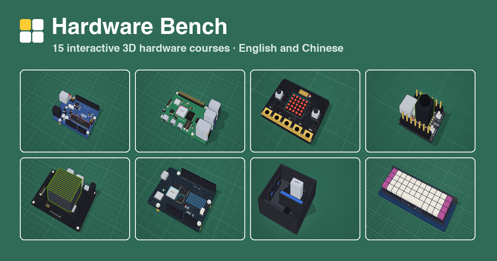

# Hardware Bench · 硬件学堂

Free, interactive electronics courses for real boards, in English and 简体中文. Every lesson shows its circuit in 3D, explains each part, and lets you run the code in a simulator before you wire anything.

**Live site:** https://majiayu000.github.io/hardware-bench/



| Course | Lessons | Language |
|---|---|---|
| **Development boards** | | |
| Arduino Uno: Desk Gadgets | 10 | C++ |
| Raspberry Pi 5: A Computer with Pins | 11 | Python |
| ESP32 DevKitC: Wi-Fi in MicroPython | 10 | MicroPython |
| Raspberry Pi Pico 2 W: MicroPython Starter | 10 | MicroPython |
| BBC micro:bit V2: Code Your First Gadgets | 10 | MicroPython |
| Arduino Nano ESP32: Small Board, Big Projects | 10 | C++ |
| **AI boards** | | |
| XIAO ESP32S3 Sense: Eyes and Ears | 10 | C++ |
| Arduino UNO Q: Two Brains | 10 | C++ + Python |
| Raspberry Pi 5 + AI HAT+ 2: Local AI | 8 | Shell + Python |
| NVIDIA Jetson Orin Nano Super: AI on Your Desk | 8 | Shell + Python |
| **Hands-on builds** | | |
| PC Build: Motherboard | 12 | hands-on |
| PC Build: From Parts to First Boot | 10 | hands-on |
| PC Upgrade: Graphics Card and SSD | 8 | hands-on |
| Mechanical Keyboard: Build Your Own | 8 | hands-on |
| Soldering Basics: Your First Kit | 9 | hands-on |

No account, no tracking, no build step: progress stays in your browser, and the site loads nothing from other servers.

> **Early release.** Pins, commands and APIs are checked against official documentation, but not every lesson has been run on a real board yet. If something is wrong, please [open an issue](https://github.com/majiayu000/hardware-bench/issues).

## Run it locally

The pages use ES modules, so they need a web server rather than `file://`:

```bash
python3 -m http.server 5180
```

Then open http://localhost:5180.

## How it is built

```
index.html, hub.js       home page: board cards, progress, AI boards coming next
engine/                  shared engine: app, 3D scene (three.js), part kit, sims, i18n, guide, styles
engine/vendor/three/     three.js r160, vendored
engine/fonts/            self-hosted fonts
boards/boards.js         which boards the home page lists, plus site links
boards/<id>/             one course: index.html, content.js, zh.js (Chinese), cover.png
skill/                   instructions, schema and validator for adding a course
```

A course is plain data in `content.js`: the board model and pin map, then the lessons with their circuits, numbered labels, code and simulated experiments. `zh.js` maps every English string to Chinese. The engine is shared by every course.

## Add or change a course

Read `skill/SKILL.md` (the workflow) and `skill/references/content-schema.md` (every field). Check a course before opening it:

```bash
bun skill/scripts/validate.mjs boards/<id>
bun skill/scripts/strings.mjs boards/<id> --missing
```

The validator checks pins, breadboard holes, wires, labels, code-trace line numbers, sim settings and Chinese coverage. `node` works too.

`skill/` is also an agent skill: copy `skill/` together with this site (as `template/`) into `~/.claude/skills/learn-hardware-site/` and a coding agent can build new courses with it.

## Licence

- Code (`engine/` except `vendor/` and `fonts/`, `hub.js`, `skill/scripts/`): [MIT](LICENSE)
- Course content (lesson text, translations, board data, images): [CC BY-NC 4.0](LICENSE-CONTENT.md)
- three.js: MIT, © three.js authors. Fonts (Space Grotesk, Instrument Sans, IBM Plex Mono): SIL Open Font License 1.1.

## Credits

- Design inspired by [learn-arduino](https://learn-arduino-red.vercel.app/) by [@DilumSanjaya](https://x.com/DilumSanjaya).
- Facts come from the vendors' own documentation: Arduino, Raspberry Pi, Espressif, Seeed Studio, the micro:bit Foundation, NVIDIA, Hailo and Intel. Each `content.js` says which sources it follows.
